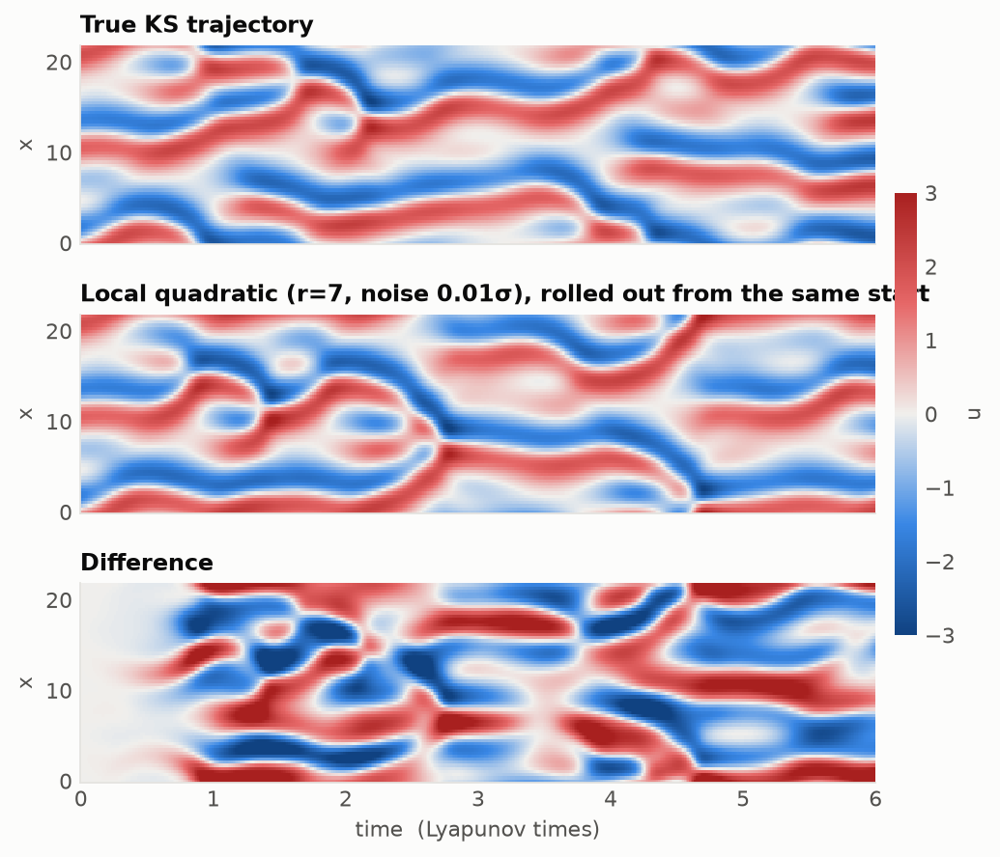

# lyapunov-horizon

Can a small neural network learn to forecast a chaotic system, the 1D Kuramoto–Sivashinsky equation, when the equation is deterministic but tiny errors grow exponentially? I found that a 199k-parameter Fourier Neural Operator tracks the true trajectory for about 4.5 Lyapunov times (the best baseline manages 0.94; the exact equations with a 0.1% initial error manage 6.1), and after it diverges its free runs still have the right long-run statistics.



```bash
pip install -e ".[dev]"
pip install torch --index-url https://download.pytorch.org/whl/cpu
python scripts/generate_data.py
python scripts/train_fno.py
python scripts/run_baselines.py --fno checkpoints/fno.pt
```

**See [documentation.md](documentation.md)** for the physics, setup, data format, evaluation protocol, how to add a model, the results, the FNO emulator, and the roadmap.
