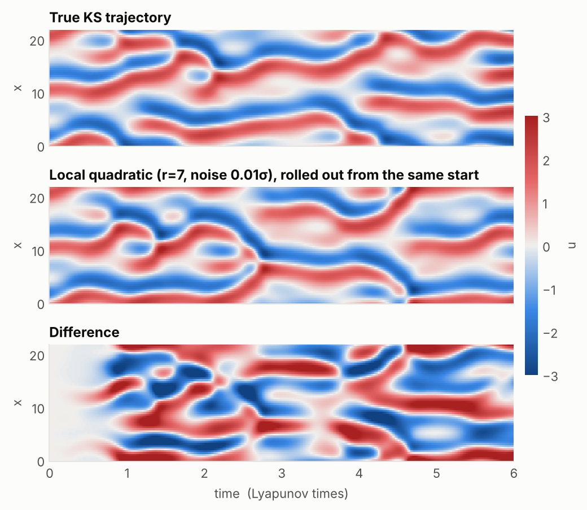
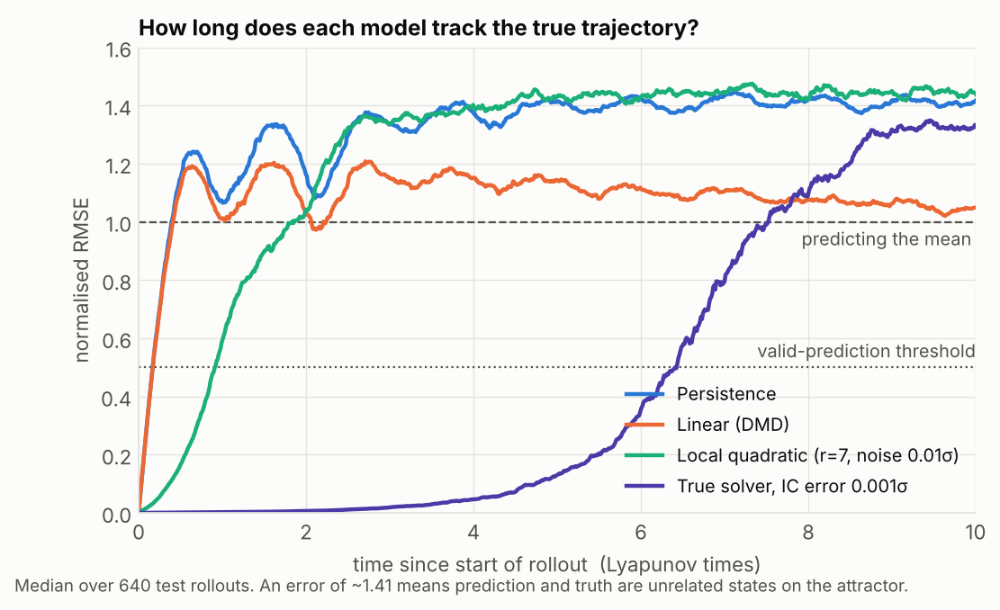
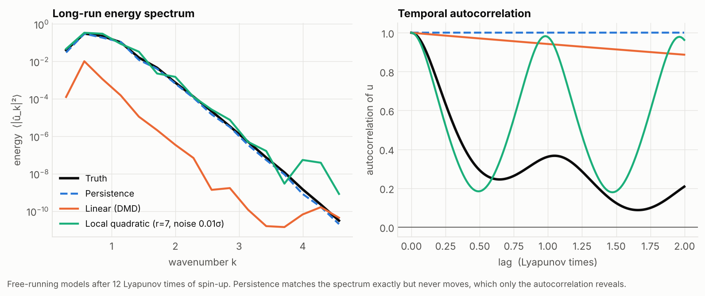

# lyapunov-horizon

Learned emulators for the 1D Kuramoto–Sivashinsky equation: rollout horizons, long-run statistics and calibration.

The project asks one question: **how far past the chaos-limited prediction horizon can a learned model stay useful?** Instead of solving the PDE, a model learns to predict the next state from the current one (self-supervised, like next-token prediction in an LLM) and is then rolled out autoregressively. Every model is judged twice:

- **Weather:** how long does it track the true trajectory, measured in Lyapunov times?
- **Climate:** once it has inevitably diverged, does it still behave like the real system?

Everything runs on a laptop CPU.



## The system

$$u_t + u\,u_x + u_{xx} + u_{xxxx} = 0, \qquad x \in [0, L),\ \text{periodic}$$

The defaults use the standard chaotic benchmark: L = 22, with 64 grid points and snapshots every 0.25 time units. The term $u_{xx}$ injects energy at large scales, $u_{xxxx}$ removes it at small scales, and $u\,u_x$ moves it between them. The result is spatiotemporal chaos, a 1D cousin of turbulence.

- **Solver:** pseudo-spectral ETDRK4 (Kassam & Trefethen 2005), batched over trajectories. Tests check 4th-order convergence, conservation of the mean, and exact decay of linear modes.
- **Lyapunov exponent:** measured with the two-trajectory method at **λ₁ ≈ 0.049**. This matches the published 0.048 (Cvitanović, Davidchack & Siminos 2010). One **Lyapunov time** is T_λ = 1/λ₁ ≈ 20.4 time units, or 82 snapshots, and every result below is measured in units of it.

## Quick start

```powershell
python -m venv .venv
.venv\Scripts\activate            # macOS/Linux: source .venv/bin/activate
pip install -e ".[dev]"

python scripts/generate_data.py   # ~1 min: Lyapunov exponent + 64/16/32 train/val/test trajectories
python scripts/run_baselines.py   # a few minutes: fits, evaluates, writes results/ and figures/
pytest                             # solver tests (pytest -m "not slow" skips the Lyapunov check)
```

Data (~100 MB) goes to `data/` and is git-ignored, so regenerate it with the first script.

## Baselines

| Model | 1-step error | Valid prediction time (T_λ) | Spectrum error | Distribution W₁ | Autocorrelation error |
|---|---|---|---|---|---|
| Persistence (u_{n+1} = u_n) | 0.038 | 0.22 | 0.11 | 0.03 | 0.71 |
| Linear / DMD | 0.038 | 0.22 | 2.60 | 0.74 | 0.64 |
| Local quadratic rule (r = 7) | 0.003 | **0.94** | 0.49 | 0.07 | **0.37** |
| *True solver, 0.1% initial error* | — | *6.1* | — | — | — |

The errors are normalised by the attractor's standard deviation. The valid prediction time is the first time this normalised error exceeds 0.5. The climate scores compare free runs of 37 T_λ with the true statistics; lower is better. The local rule's radius and training noise were chosen on the validation set.





### What the baselines already show

1. **The best linear model is persistence.** On a statistically stationary attractor, the energy in each Fourier mode is constant on average. That forces the best linear one-step predictor to be almost the identity map, so DMD can't beat "nothing changes" in the short term. In free runs it slowly decays towards the mean field.
2. **One-step accuracy ≠ stable rollouts.** Without training noise, the local quadratic rule is 20× more accurate per step than persistence, yet every rollout blows up within a fraction of a Lyapunov time. It has never seen small-scale errors, so it amplifies them. Adding 1% noise to the training inputs teaches it to pull perturbed states back towards the attractor. This is the same instability that learned emulators face, in a model small enough to understand completely.
3. **Static statistics can be fooled.** Persistence has a perfect spectrum and value distribution because it never moves. Only the autocorrelation catches it. Meanwhile the local rule settles into an almost periodic oscillation instead of chaos: the spectrum looks plausible, but the autocorrelation says it's the wrong system.
4. **The ceiling is chaos itself.** Even the exact equations, started with a 0.1% error, lose the trajectory after about 6 Lyapunov times. No model can do much better without better initial data, because the horizon grows only like ln(1/error).

The target for a learned emulator is to beat **0.94 T_λ** while also getting the climate right.

## Layout

```
src/lyapunov_horizon/
  ks.py         ETDRK4 solver
  lyapunov.py   largest Lyapunov exponent
  data.py       dataset generation / loading
  baselines.py  persistence, climatology, DMD, local quadratic rule, rollout()
  metrics.py    NRMSE, valid prediction time, spectrum, distribution, autocorrelation
  plotting.py   shared figure style
scripts/        generate_data.py, run_baselines.py
tests/          solver tests
```

## Roadmap

- [x] Solver, data, Lyapunov time
- [x] Baselines and evaluation (weather + climate)
- [ ] Neural emulator (small FNO / transformer over spatial patches) in PyTorch on CPU
- [ ] Training tricks for stable rollouts: noise injection, multi-step (unrolled) loss
- [ ] Probabilistic emulator: ensembles, calibration, CRPS
- [ ] Latent (JEPA-style) prediction vs. raw-state prediction
- [ ] Larger domains (L = 44, 100): more chaos, shorter horizons

## References

- Kassam & Trefethen, *Fourth-order time-stepping for stiff PDEs*, SIAM J. Sci. Comput. 26 (2005)
- Cvitanović, Davidchack & Siminos, *On the state space geometry of the Kuramoto–Sivashinsky flow in a periodic domain*, SIAM J. Appl. Dyn. Syst. 9 (2010), [arXiv:0709.2944](https://arxiv.org/abs/0709.2944)
- Pathak et al., *Model-free prediction of large spatiotemporally chaotic systems from data: a reservoir computing approach*, PRL 120 (2018)
- Vlachas et al., *Backpropagation algorithms and reservoir computing in recurrent neural networks for the forecasting of complex spatiotemporal dynamics*, Neural Networks 126 (2020)
