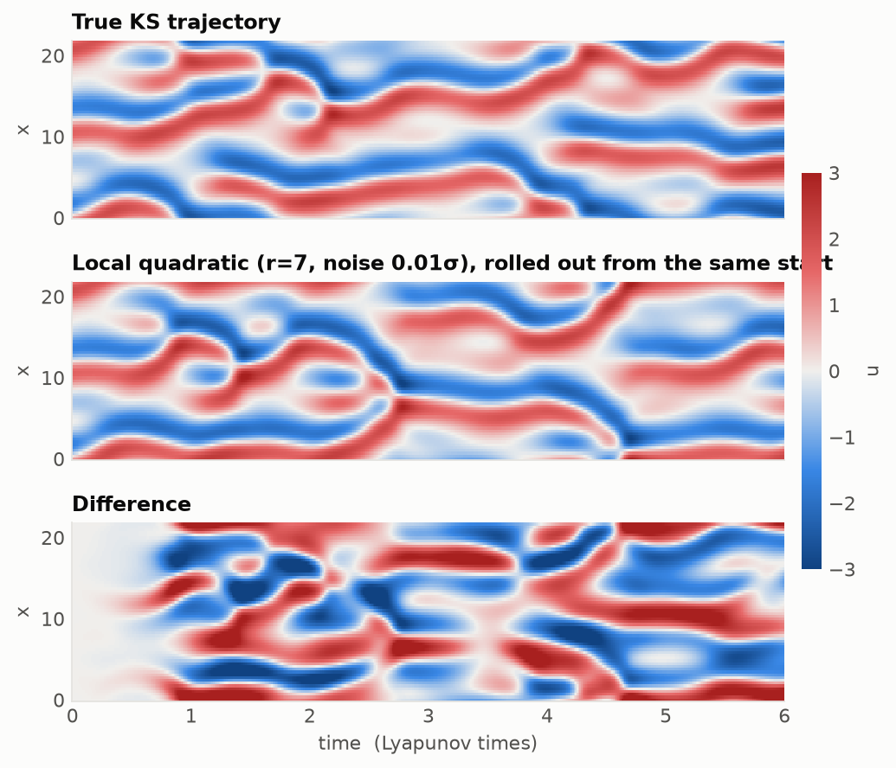
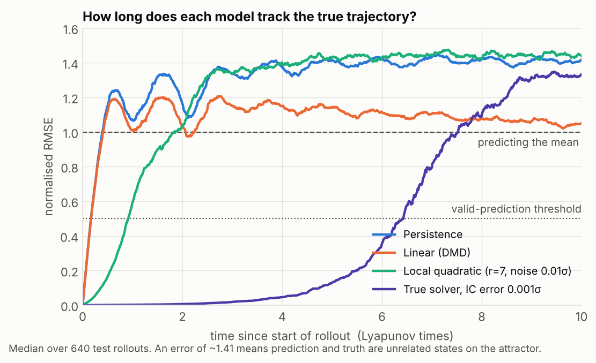
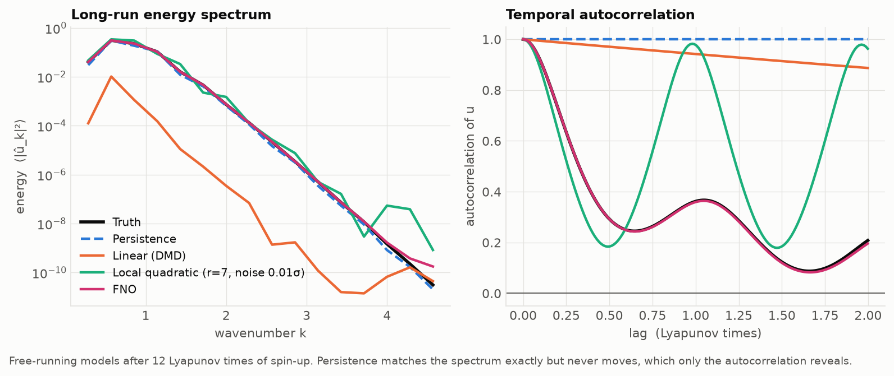

# lyapunov-horizon documentation

1. [Overview](#overview)
2. [The system](#the-system)
3. [Setup](#setup)
4. [Running the pipeline](#running-the-pipeline)
5. [Data](#data)
6. [Evaluation protocol](#evaluation-protocol)
7. [Adding a model](#adding-a-model)
8. [Baseline results](#baseline-results)
9. [Code layout](#code-layout)
10. [Roadmap](#roadmap)
11. [References](#references)

## Overview

The project asks one question: **how far past the chaos-limited prediction horizon can a learned model stay useful?** Instead of solving the PDE, a model learns to predict the next state from the current one (self-supervised, like next-token prediction in an LLM) and is then rolled out autoregressively, feeding its own predictions back in. Every model is judged twice:

- **Weather:** how long does it track the true trajectory, measured in Lyapunov times?
- **Climate:** once it has inevitably diverged, does it still behave like the real system?

Everything runs on a laptop CPU.

## The system

$$u_t + u\,u_x + u_{xx} + u_{xxxx} = 0, \qquad x \in [0, L),\ \text{periodic}$$

The defaults use the standard chaotic benchmark: L = 22, with 64 grid points and snapshots every 0.25 time units. The term $u_{xx}$ injects energy at large scales, $u_{xxxx}$ removes it at small scales, and $u\,u_x$ moves it between them. The result is spatiotemporal chaos, a 1D cousin of turbulence.

- **Solver:** pseudo-spectral ETDRK4 (Kassam & Trefethen 2005), batched over trajectories, with internal step h = 0.05 (5 substeps per snapshot). Tests check 4th-order convergence, conservation of the mean, and the evolution of small linear modes.
- **Lyapunov exponent:** measured with the two-trajectory (Benettin) method at **λ₁ ≈ 0.049 ± 0.001**. This matches the published 0.048 (Cvitanović, Davidchack & Siminos 2010). One **Lyapunov time** is T_λ = 1/λ₁ ≈ 20.4 time units, or about 82 snapshots (81.6), and every result is measured in units of it.

## Setup

Python ≥ 3.10; developed on Python 3.14 under WSL.

```bash
python -m venv .venv
source .venv/bin/activate          # Windows PowerShell: .venv\Scripts\activate
pip install -e ".[dev]"
```

The neural emulators (in progress) need PyTorch. On a CPU-only machine, install the CPU build to avoid downloading CUDA libraries:

```bash
pip install torch --index-url https://download.pytorch.org/whl/cpu
```

The editable install records the repository's absolute path. If you move the repository, run `pip install -e ".[dev]"` again.

## Running the pipeline

```bash
python scripts/generate_data.py   # ~1 min: Lyapunov exponent + 64/16/32 train/val/test trajectories
python scripts/run_baselines.py   # ~13 min (mostly single-threaded): fits, evaluates, writes results/ and figures/
pytest                            # all tests; pytest -m "not slow" skips the Lyapunov check
```

`generate_data.py` options: `--L`, `--N` (domain length and grid; e.g. `--L 44 --N 128` for a larger, more chaotic box), `--h` (solver step), `--dt` (snapshot interval), `--burn-in`, `--samples` (snapshots per trajectory), `--n-train`, `--n-val`, `--n-test`, `--seed`, `--out`. The default output is `data/ks_L22_N64.npz`.

`run_baselines.py` options: `--data` (input dataset), `--ic-error` (initial-condition error for the true-solver ceiling, as a fraction of σ_u; default 1e-3), `--out` (default `results/baselines.json`), `--figures` (default `figures/`), `--no-figures`.

## Data

`generate_data.py` writes two files:

- `data/ks_L22_N64.npz` (~100 MB, git-ignored, so regenerate it rather than committing it). Arrays `train`, `val`, `test` of shape (trajectories, 4001, 64), float32, plus `x`, `dt`, `L`, `lambda_1`, `N`, `h` and `lambda_1_stderr`. Load it with `lyapunov_horizon.data.load()`, which returns a `Dataset`.
- `data/ks_L22_N64.json`: the arguments used, the per-run Lyapunov estimates and σ_u.

| Split | Trajectories | Snapshots each | Length | Seed |
|---|---|---|---|---|
| train | 64 | 4001 | 49 T_λ | `seed` |
| val | 16 | 4001 | 49 T_λ | `seed + 1` |
| test | 32 | 4001 | 49 T_λ | `seed + 2` |

Each trajectory starts from a random initial condition and is integrated for 500 time units before saving, so every snapshot lies on the attractor. The separate seeds make the splits independent. The Lyapunov estimate uses `seed + 1000`.

`Dataset.sigma` is the pointwise standard deviation of u over the **training split** (σ_u ≈ 1.19). All errors are normalised by it.

## Evaluation protocol

Every model, baseline or neural, is evaluated by the same two functions in `lyapunov_horizon/evaluate.py`, so the numbers are directly comparable. Multiples of T_λ are rounded to whole snapshots.

**All hyperparameter and model selection uses the validation split only.** The test split is used once, for the final numbers.

### Weather: `evaluate_weather(model, ds, split="test")`

- A rollout starts every 2 T_λ along each trajectory and runs for 10 T_λ: 640 rollouts on the test split.
- **NRMSE**: the spatial RMS error divided by σ_u. 0 is perfect, 1.0 is what predicting the mean gives, and ≈ 1.41 is the error between two unrelated states on the attractor.
- **Valid prediction time (VPT)**: the first time the NRMSE exceeds 0.5, in Lyapunov times. A rollout that never crosses is assigned one step past the horizon (≈ 10 T_λ).
- Reported: the median one-step NRMSE and the mean, median, 10% and 90% quantiles of VPT. The NRMSE curves are kept for plotting.
- `ic_error > 0` perturbs the start states by that fraction of σ_u, e.g. to measure how quickly the exact equations themselves lose the trajectory.

### Climate: `evaluate_climate(model, ds, split="test")`

The model free-runs from each trajectory's first state for the full trajectory length (49 T_λ). The first 12 T_λ are discarded and the remaining 37 T_λ are compared with the true trajectories:

| Metric | Definition |
|---|---|
| `spectrum_err` | mean \|log₁₀ E_pred(k) − log₁₀ E_true(k)\| over wavenumbers 1 ≤ k ≤ N/4 |
| `pdf_w1` | Wasserstein-1 distance between the distributions of u, divided by σ_u |
| `acf_err` | RMS difference of the temporal autocorrelation, up to a 2 T_λ lag |
| `diverged` | fraction of free runs that blew up |

All four must be read together. A model that freezes in place (persistence) has the right spectrum and distribution but the wrong dynamics, and only the autocorrelation catches it.

If any free run diverges, `spectrum_err`, `pdf_w1` and `acf_err` are NaN. Scoring only the surviving runs would let a model that usually blows up look as good as one that never does. `drop_diverged=True` scores the survivors instead. It is meant for diagnostics during training, never for reported numbers.

## Adding a model

Every model subclasses `lyapunov_horizon.baselines.Model`:

```python
class Model:
    name = "model"

    def fit(self, train: np.ndarray) -> "Model":   # train: (n_traj, n_time, N)
        return self

    def step(self, u: np.ndarray) -> np.ndarray:    # (B, N) -> (B, N), one snapshot ahead
        raise NotImplementedError
```

`step` advances a batch of states by one snapshot interval (dt = 0.25). It must treat each row independently: `rollout()` stops passing a trajectory to `step` once it has diverged, so the row index of a given trajectory changes over a rollout. A neural model should take and return NumPy arrays (running the network under `torch.no_grad()`), so that the same evaluation code applies.

`rollout(model, u0, n_steps)` runs the autoregressive loop and returns (B, n_steps + 1, N). A trajectory that becomes non-finite or exceeds amplitude 100 is marked as diverged: it is NaN from then on and is no longer stepped.

```python
from lyapunov_horizon.data import load
from lyapunov_horizon.evaluate import evaluate_climate, evaluate_weather

ds = load("data/ks_L22_N64.npz")
model = MyModel().fit(ds.train)
print(evaluate_weather(model, ds, "val").metrics)   # tune on val
print(evaluate_climate(model, ds, "val").metrics)
```

## Baseline results

Test split.

| Model | 1-step error | Valid prediction time (T_λ) | Spectrum error | Distribution W₁ | Autocorrelation error |
|---|---|---|---|---|---|
| Persistence (u_{n+1} = u_n) | 0.038 | 0.22 | 0.11 | 0.03 | 0.71 |
| Linear / DMD | 0.038 | 0.22 | 2.60 | 0.74 | 0.64 |
| Local quadratic rule (r = 7) | 0.003 | **0.94** | 0.49 | 0.07 | **0.37** |
| *True solver, 0.1% initial error* | — | *6.1* | — | — | — |

Errors are normalised by σ_u; lower is better for every column except the valid prediction time. No baseline diverged in its free runs. Climatology (always predict the mean field) has a one-step error of 0.95 and a VPT of 0.01 T_λ; it sets the "no skill" level and is left out of the climate comparison. The local rule's radius (r = 7) and training-input noise (0.01 σ_u) were chosen on the validation set. The full numbers are in `results/baselines.json`.







### What the baselines already show

1. **The best linear model is persistence.** On a statistically stationary attractor, the energy in each Fourier mode is constant on average. That forces the best linear one-step predictor to be almost the identity map, so DMD can't beat "nothing changes" in the short term. In free runs it slowly decays towards the mean field.
2. **One-step accuracy ≠ stable rollouts.** Without training noise, the local quadratic rule is 20× more accurate per step than persistence, yet every rollout blows up within a fraction of a Lyapunov time. It has never seen small-scale errors, so it amplifies them. Adding 1% noise to the training inputs teaches it to pull perturbed states back towards the attractor. This is the same instability that learned emulators face, in a model small enough to understand completely.
3. **Static statistics can be fooled.** Persistence has a perfect spectrum and value distribution because it never moves. Only the autocorrelation catches it. Meanwhile the local rule settles into an almost periodic oscillation instead of chaos: the spectrum looks plausible, but the autocorrelation says it's the wrong system.
4. **The ceiling is chaos itself.** Even the exact equations, started with a 0.1% error, lose the trajectory after about 6 Lyapunov times. No model can do much better without better initial data, because the horizon grows only like ln(1/error).

The target for a learned emulator is to beat **0.94 T_λ** while also getting the climate right.

## Code layout

```
src/lyapunov_horizon/
  ks.py         ETDRK4 solver
  lyapunov.py   largest Lyapunov exponent
  data.py       Dataset, dataset generation, save() / load()
  baselines.py  Model interface, persistence, climatology, DMD, local quadratic rule, rollout()
  metrics.py    NRMSE, valid prediction time, spectrum, distribution, autocorrelation
  evaluate.py   the shared weather/climate protocol: evaluate_weather(), evaluate_climate()
  plotting.py   shared figure style and fixed colour per model
scripts/
  generate_data.py   simulate the KS equation and save the splits
  run_baselines.py   select the local rule on val, evaluate on test, write results/ and figures/
tests/
  test_ks.py                  solver
  test_baselines_metrics.py   baselines, rollout, metrics
  test_evaluate.py            evaluation protocol
```

## Roadmap

- [x] Solver, data, Lyapunov time
- [x] Baselines and evaluation (weather + climate)
- [ ] Neural emulator (small FNO / transformer over spatial patches) in PyTorch on CPU
- [ ] Training tricks for stable rollouts: noise injection, multi-step (unrolled) loss
- [ ] Probabilistic emulator: ensembles, calibration, CRPS
- [ ] Latent (JEPA-style) prediction vs. raw-state prediction
- [ ] Larger domains (L = 44, 100): more chaos, shorter horizons

## References

- Kassam & Trefethen, *Fourth-order time-stepping for stiff PDEs*, SIAM J. Sci. Comput. 26 (2005)
- Cvitanović, Davidchack & Siminos, *On the state space geometry of the Kuramoto–Sivashinsky flow in a periodic domain*, SIAM J. Appl. Dyn. Syst. 9 (2010), [arXiv:0709.2944](https://arxiv.org/abs/0709.2944)
- Pathak et al., *Model-free prediction of large spatiotemporally chaotic systems from data: a reservoir computing approach*, PRL 120 (2018)
- Vlachas et al., *Backpropagation algorithms and reservoir computing in recurrent neural networks for the forecasting of complex spatiotemporal dynamics*, Neural Networks 126 (2020)
